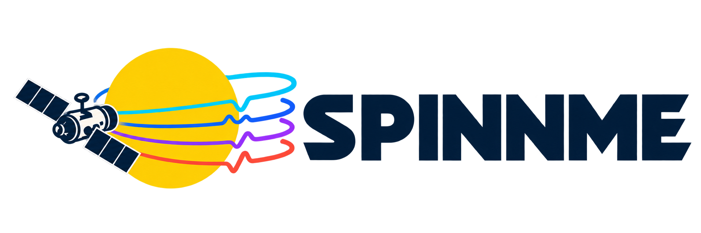

[](https://spinnme.readthedocs.io/en/stable/?badge=stable)
[](https://github.com/RobertJaro/spinnme/actions/workflows/ci.yml)
[](https://pypi.org/project/spinnme/)
[](https://www.python.org/)
[](https://github.com/RobertJaro/spinnme/blob/main/LICENSE)

<p align="center"></p>

**Invert solar Stokes observations. Export magnetic and velocity maps with WCS.**

SPINNME fits spherical neural Milne–Eddington inversions of **HMI, Hinode SP, Solar Orbiter PHI and custom FITS** data. It fits a new model to your selected calibrated polarized spectra to estimate magnetic-field, velocity and atmosphere maps. It supports multiple datasets, instruments and spectral lines, with one CLI and Python loader for training and exports. New to inversions? Start with the [beginner FAQ](https://spinnme.readthedocs.io/en/stable/faq.html).

---

[](https://spinnme.readthedocs.io/en/stable/quickstart.html)
[](https://colab.research.google.com/github/RobertJaro/spinnme/blob/main/examples/colab/circular.ipynb)
[](https://colab.research.google.com/github/RobertJaro/spinnme/blob/main/examples/colab/hmi.ipynb)
[](https://colab.research.google.com/github/RobertJaro/spinnme/blob/main/examples/colab/hinode_sp.ipynb)
[](https://colab.research.google.com/github/RobertJaro/spinnme/blob/main/examples/colab/phi.ipynb)
[](https://colab.research.google.com/github/RobertJaro/spinnme/blob/main/examples/colab/custom_fits.ipynb)

### Install

With Python **3.11+**:

```bash
pip install spinnme
```

For archive downloads, install `pip install 'spinnme[download]'`. See [installation](https://spinnme.readthedocs.io/en/stable/installation.html) for optional features and source installation.

### Run the HMI quickstart

Prefer an online notebook? Use the [Colab examples](https://spinnme.readthedocs.io/en/stable/colab.html) for HMI, Hinode SP, PHI, custom FITS or a download-free circular-pattern trial.

Install archive support and use your registered JSOC email. Device selection is automatic, using an available GPU accelerator for training and falling back to CPU. Run all commands from the same working directory:

```bash
pip install 'spinnme[download]'
export JSOC_EMAIL='you@example.org'
spinnme download hmi --product S_720s --start 2024-03-23T01:00:00 --time-scale tai --email "$JSOC_EMAIL" --output ./data/hmi/stokes
spinnme download hmi-transmission --input ./data/hmi/stokes \
  --output ./data/hmi/transmission --email "$JSOC_EMAIL"
spinnme run --config hmi/full_disk --data_path ./data/hmi --run_path ./runs/hmi
spinnme export ./runs/hmi/inversion.pme --all-observations --format fits --output ./products/hmi
```

The two download commands fetch Stokes data and matching transmission profiles. The run writes `inversion.pme`; the export command writes **Br / Btheta / Bphi** FITS maps. The bundled 256 × 256 grid and 1,000-step budget are a starting example, not a convergence criterion. The [quickstart](https://spinnme.readthedocs.io/en/stable/quickstart.html) explains each step; [examples/hmi.sh](https://github.com/RobertJaro/spinnme/blob/main/examples/hmi.sh) runs the same four commands. To try the package without archive access, use the [offline example](https://spinnme.readthedocs.io/en/stable/circular.html).

### Invert your own data

Inputs need calibrated I/Q/U/V, correct solar WCS, observer metadata and wavelength sampling. Choose a template and follow its preparation guide:

| Input | Template | Guide |
| --- | --- | --- |
| HMI subframes | `hmi/subframe` | [CLI cropping and inversion](https://spinnme.readthedocs.io/en/stable/hmi.html#invert-an-hmi-subframe) |
| HMI Stokes segments | `hmi/full_disk` | [HMI](https://spinnme.readthedocs.io/en/stable/hmi.html) |
| Hinode SP raster (6301 + 6302 Å) | `hinode/sp` | [Hinode](https://spinnme.readthedocs.io/en/stable/hinode.html) |
| PHI HRT / FDT | `phi/hrt`, `phi/fdt` | [PHI](https://spinnme.readthedocs.io/en/stable/phi.html) |
| Custom Stokes FITS | `generic/stokes_cube` | [Custom data](https://spinnme.readthedocs.io/en/stable/custom.html) |
| Multiple spectral lines | `generic/multiple_lines` | [Custom data](https://spinnme.readthedocs.io/en/stable/custom.html) |

Copy a template, edit its reader settings and run:

```bash
spinnme config copy generic/stokes_cube --output custom.yaml
spinnme run --config custom.yaml --input './data/custom/*.fits' --output ./runs/custom --export fits
```

[Training options](https://spinnme.readthedocs.io/en/stable/training_options.html) covers budgets, optimizers, model size, normalization, validation and sampling. [Training](https://spinnme.readthedocs.io/en/stable/training.html) covers resume and W&B. Uniform sampling is the default; polarization oversampling and instrument corrections are opt-in.

### Export from Python

```python
from spinnme import load

with load("runs/hmi/inversion.pme") as snapshot:
    result = snapshot.evaluate(snapshot.observations[0]["id"], parameters=["Brtp", "Blos", "Vdop", "vmac", "damping"])
    result.write_fits("products/python/fits")
    result.write_npz("products/python/parameters.npz")
    result.write_jpg("products/python/preview")
```

FITS writes one parameter per file with WCS, units and a validity mask. NPZ bundles the arrays and metadata; JPG provides scalar previews. The [Python export guide](https://spinnme.readthedocs.io/en/stable/python_exports.html) demonstrates custom resolution, regions and cadence. No azimuth disambiguation is applied; see [field conventions](https://spinnme.readthedocs.io/en/stable/method.html).

[Documentation](https://spinnme.readthedocs.io/en/stable/index.html) · [Installation](https://spinnme.readthedocs.io/en/stable/installation.html) · [Troubleshooting](https://spinnme.readthedocs.io/en/stable/troubleshooting.html) · [Contributing](https://github.com/RobertJaro/spinnme/blob/main/CONTRIBUTING.md) · [Citation](https://github.com/RobertJaro/spinnme/blob/main/CITATION.cff) · [GPL-3.0 license](https://github.com/RobertJaro/spinnme/blob/main/LICENSE)
